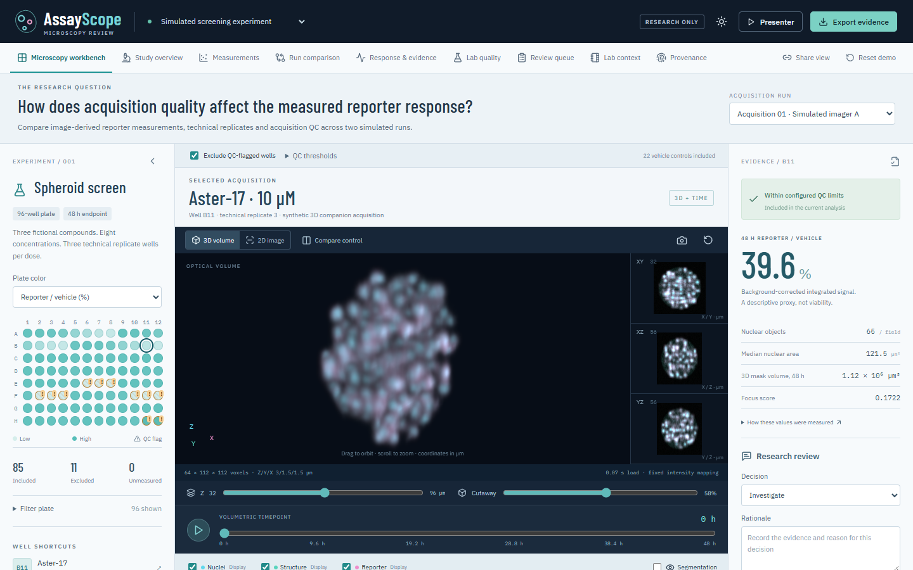
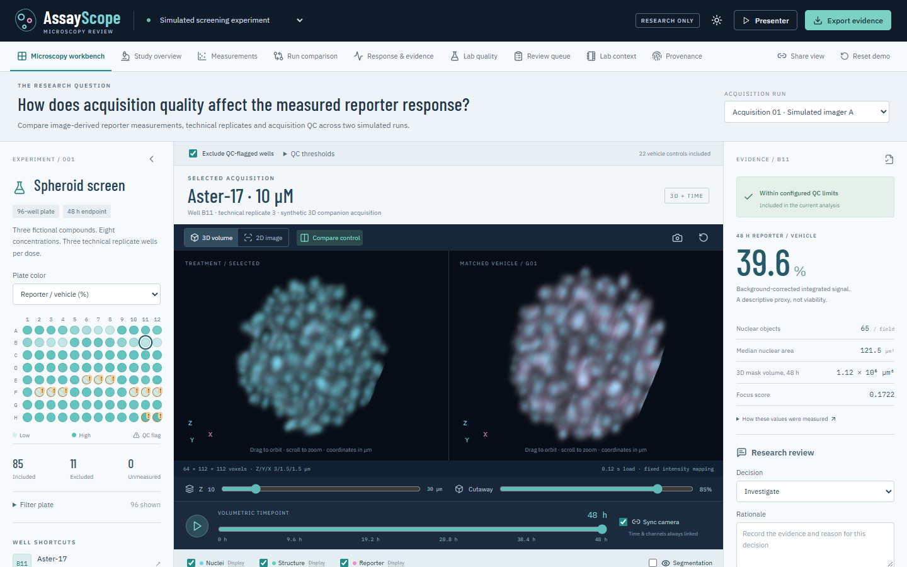
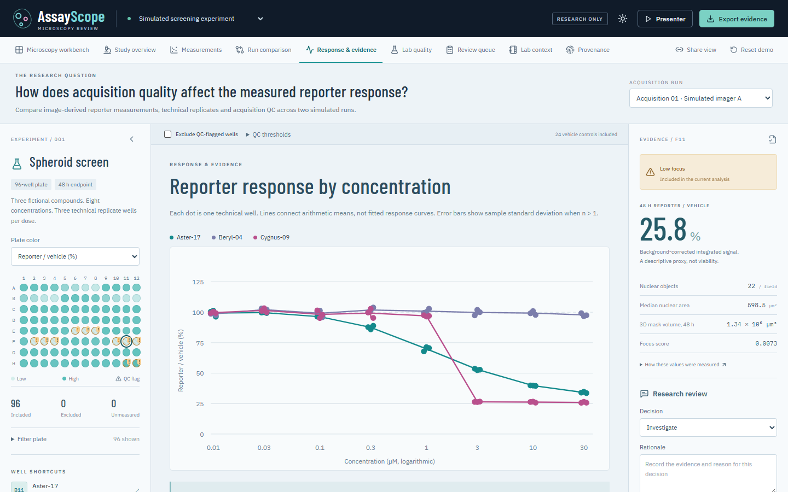
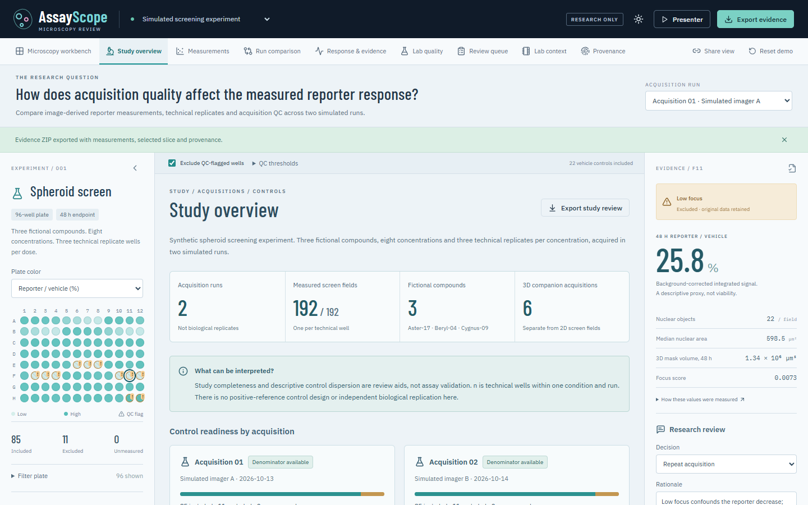
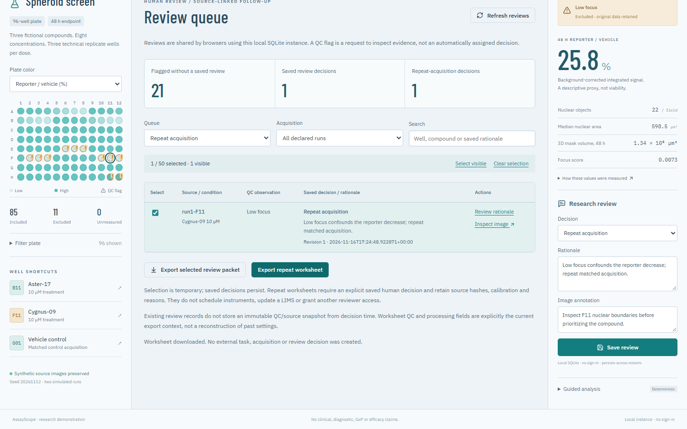
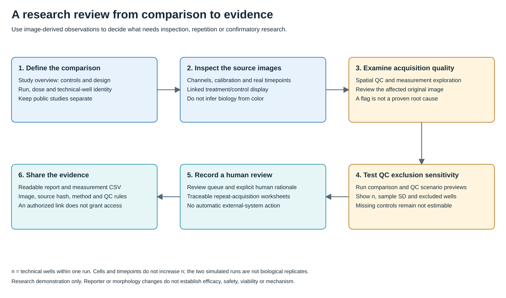
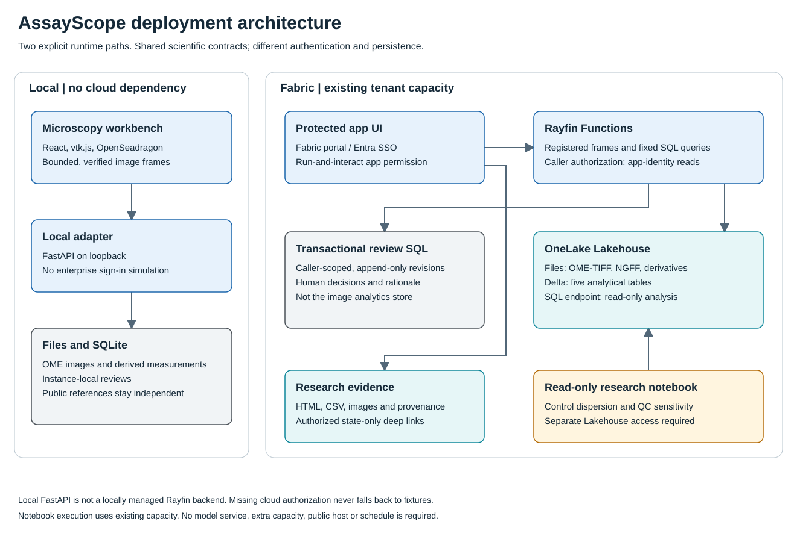

# AssayScope

[](https://github.com/anuraagr/assayscope-fabric/actions/workflows/checks.yml)

AssayScope is a **research-only microscopy review workbench**. It connects a plate result
to its source images, measurement method, acquisition-quality observations and human
review rationale. Run it locally without cloud services, or deploy the protected app
and analytical data into an existing Microsoft Fabric workspace.



*Actual local workbench capture using the simulated screening experiment. Public reference
images have separate licenses and are not part of this response analysis.*

The synthetic experiment contains three fictional compounds and two simulated acquisition
runs. It demonstrates how acquisition QC affects the interpretation of reporter measurements.
This is not a medical device, diagnostic tool, GxP-validated system, or production-ready
regulated workflow. A response here is not evidence of efficacy, safety or mechanism.

## Start here

| Your task | Read or run |
|---|---|
| Use the expanded in-app lab workflows | [Study, measurements, scenarios, review queue and context](docs/lab-workflows.md) |
| Follow the complete app, data and deployment story | [Illustrated end-to-end walkthrough](docs/end-to-end.md) |
| Understand the lab workflow and its limits | [Lab research guide](docs/lab-research-guide.md) |
| Try the populated workbench | [Local quickstart](#run-locally) |
| Review the system and data boundaries | [Architecture and diagrams](docs/architecture.md) |
| Examine cross-run QC and control variability | [Research report and Fabric notebook](docs/fabric-research.md) |
| Deploy ontology and evidence questions | [Knowledge deployment](docs/knowledge-deployment.md) and [external-context boundaries](docs/knowledge-context.md) |
| Deploy into your own workspace | [Deployment guide](docs/deployment.md) |
| Bring authorized images and metadata | [Adapter guide](docs/adapter-guide.md) |
| Evaluate evidence, support and changes | [Verification](docs/verification.md), [support](SUPPORT.md), [contributing](CONTRIBUTING.md) |

The [documentation index](docs/index.md) provides reading paths for scientists, imaging
teams and platform engineers.

## Application views

| Linked treatment/control inspection | Response and technical-well evidence |
|---|---|
|  |  |

| Study and control review | Persistent review queue |
|---|---|
|  |  |

The browser also includes a **measurement scatter/table explorer**, **run comparison**,
**explicit QC scenario previews**, **source-linked lab context**, and **plate spatial QC**.
These are integrated views over the same study, with bounded exports and actual local/
tenant data paths; no additional cloud service is needed.
The 2026-11-16 feature expansion is locally verified; its update to the protected Fabric
host is pending because the existing capacity is inactive. See [current status](docs/progress.md).

The [illustrated walkthrough](docs/end-to-end.md) explains what to select, what each
screen means, how to investigate a QC-confounded field, and how the evidence reaches
Fabric tables, the research notebook and the optional knowledge layer.

## Research workflow



| Research question | Evidence available | What remains a scientific judgment |
|---|---|---|
| Is a low reporter measurement accompanied by an acquisition problem? | Original images, focus/saturation/illumination flags and thresholds | Whether a repeat acquisition is needed and what caused the observation |
| Does the comparison depend on excluding wells? | Before/after QC means, included controls, technical n and sample SD | Whether the inclusion rule is appropriate for the real assay |
| Are the two acquisition runs behaving similarly? | Separate run summaries, control dispersion and source-linked measurements | Biological reproducibility; these runs are simulated acquisitions |
| Can another reviewer reconstruct the finding? | Evidence ZIP, source hashes, methods, units and exclusions | Access approval and independent verification of a new assay |

These are supported research-review tasks, not measured customer savings or validated
biological conclusions. [Evaluation guidance](docs/lab-research-guide.md#evaluate-benefit-in-your-lab)
explains how to measure workflow benefit without inventing ROI.

## Run locally

From this directory, with Docker Engine/Desktop and Compose v2:

```sh
docker compose up --build
```

Open **http://localhost:8000**. First startup generates the seeded dataset on CPU and
persists it, with SQLite reviews, in the named `assayscope-data` volume. No Azure
subscription, Fabric capacity, model endpoint or GPU is required to start the app.
3D rendering requires WebGL 2; 2D and orthogonal slices remain available without it.
After dependencies/images and data are prepared, the showcase works offline.

Run these commands from the root of the independent `assayscope-fabric` repository.
No other project's deployment scripts or assets are required. Local mode does not sign
in, create cloud resources or expose a public endpoint.

**Verification boundary:** native Windows and GitHub-hosted Ubuntu checks passed.
Docker was not available
on the implementation host, so the actual container build/start is **unverified**.
The [verification report](docs/verification.md) separates measured results from configuration.

### Native development

Use **Node 24**, **Python 3.12** and npm. Rayfin 1.36.2 supports Node 20/22/24, not Node 26.
Use the exact dependency files; do not ignore resolver errors. `.nvmrc` and
`.python-version` record the tested versions.

Windows PowerShell:

```powershell
python -m venv .venv
.\.venv\Scripts\python.exe -m pip install -r requirements.txt
npm ci
npm run dev
```

If `python` is not 3.12, use `py -3.12 -m venv .venv` with the Windows Python launcher,
or invoke the absolute path to your installed Python 3.12 executable.
macOS/Linux:

```sh
python3.12 -m venv .venv
.venv/bin/python -m pip install -r requirements.txt
npm ci
npm run dev
```

Open **http://localhost:5173**. The command starts Vite and the explicitly local Python
adapter; it does **not** run `rayfin dev` or provision a managed backend. Ctrl+C stops
both child processes. For a production frontend served by the same local API:

```powershell
npm run build
.\.venv\Scripts\python.exe -m uvicorn assayscope.server:app --host 127.0.0.1 --port 8000 --no-access-log
```

On macOS/Linux replace the Python executable with `.venv/bin/python`.

## What works, and what is not claimed

| Capability | Status |
|---|---|
| 96 wells/run, 3 compounds x 8 doses x 3 technical wells, 24 controls; 2 runs | Implemented and tested |
| Image-only watershed baseline, focus/saturation/illumination/count QC | Implemented; tested against separate synthetic truth |
| vtk.js multichannel 3D cutaway, six real volume frames, physical orthogonal slices | Implemented and browser-tested |
| OpenSeadragon 2D zoom/pan, channel/color/intensity controls, scale bar, labels | Implemented and browser-tested |
| Linked treatment/control camera, time and display settings | Implemented and browser-tested |
| Replicate points, sample SD, explicit exclusions and control normalization | Implemented; no forced IC50 |
| Local reviews across restart; evidence ZIP; state-only deep links; presenter/reset | Implemented and browser-tested |
| Cell Painting CC0 and BT474 CC BY 4.0 reference packs | Real selected files downloaded, hashed, converted and viewed |
| Deterministic Guided analysis | Implemented; calculations/records, not generative AI |
| Study overview / control readiness | Per-run denominator, control CV, design/coverage and explicit missing design elements |
| Measurement explorer | Nine axes, condition/inclusion/search/range filters, keyboard source navigation and scoped exports |
| Run comparison / QC scenarios | Separate technical n/SD/denominators; actual candidate analyses and explicit apply-to-view |
| Review queue / repeat worksheets | Persisted local/caller-scoped records; 50-field selection and human-decision-gated repeat exports |
| Spatial QC / lab context | Source-linked plate summaries and exact four-record example snapshot; no live LIMS inference |
| OneLake delivery, five analytical tables and cross-run SQL | Deployed; verified with actual cloud data and Fabric SSO UI |
| Protected hosting and anonymous Functions denial | Deployed; unauthenticated requests return HTTP 401 |
| Caller-scoped cloud reviews | Deployed; read path exercised; test-write approval and second-identity checks outstanding |
| Read-only research report and Fabric notebook | Implemented; same Python reduction, control dispersion, QC sensitivity and source lineage |
| Fabric IQ ontology and read-only data agent | Deployed against seven curated tables; runtime evidence and remaining gates are recorded separately |
| LIMS/ELN context | Four explicit fictional export records; no live external endpoint connected |
| Linux CI | Actual Ubuntu build/scientific/browser/guard workflow passed; software WebGL is explicit |
| Docker Compose and macOS runtime | Packaged/documented; actual execution unverified |
| Optional learned segmentation or Foundry LLM | Not implemented; not needed by the core product |
| Arbitrary instrument/LIMS connector or clinical validation | Not claimed |

### Three unmistakable data experiences

**Simulated screening experiment:** original generated images, fictional compounds and
synthetic instruments/runs. Measurements come from those images. Nuclear counts,
reporter signal and morphology are proxies, not viability or toxicity.

**Public microscopy reference:** two independent, attributed studies. They are not paired
samples, are not part of the simulated response curve, and do not become time series.

**Connected tenant data:** protected Fabric access. The delivered tenant pipeline hosts
the same explicitly synthetic research demo in your tenant; connecting it does not turn
synthetic data into a real experiment. Missing configuration/authentication fails closed.
Local fixtures are never substituted. Imported real assays require a reviewed metadata
mapping and validated analysis, as explained in the [adapter guide](docs/adapter-guide.md).

## Fetch the real reference pack separately

The core showcase does not need this download. Four exact image files total
**117,326,500 bytes**; no multi-terabyte collection is synchronized.

```powershell
.\.venv\Scripts\python.exe -m assayscope.public_data plan
.\.venv\Scripts\python.exe -m assayscope.public_data fetch
```

Or, after Compose starts:

```sh
docker compose exec showcase python -m assayscope.public_data fetch
```

Select **Public microscopy reference** in the app. Downloads expose byte progress,
resume partial files, use three bounded attempts and validate exact lengths/SHA-256.
Changed sources fail visibly, never become synthetic replacements. A selection over
2 GiB requires `--allow-over-2gb`.

See the [source manifest](config/public-sources.json), [data cards](docs/data-cards.md)
and [attribution](THIRD_PARTY_NOTICES.md). BT474's source TIFF does not identify its
three stains: the app deliberately says "Source channel 1/2/3" rather than inventing them.

## Deploy into your own Fabric tenant

The sample has been deployed and exercised in an authorized tenant. That result is not
a deployment into a reader's workspace. Resource coordinates stay in ignored local
configuration. Open your Fabric portal app item; a direct request to protected static
hosting can return 401 without its authenticated context.

Deployment into another tenant requires an explicitly chosen tenant, workspace
on an existing active capacity, permission to create/edit the app and Lakehouse,
Fabric Apps/Functions availability, scoped app-identity data access, Node 24, Python
3.12, PowerShell 7.4+, Azure CLI, and your own completed sign-in.

Copy `config/tenant.example.json` to ignored `config/tenant.local.json` and fill the
intended IDs/account and owner-confirmed prerequisites. Then:

```sh
npm run fabric:doctor -- --config config/tenant.local.json
npm run fabric:plan -- --config config/tenant.local.json
npm run fabric:apply -- --config config/tenant.local.json --confirm-costs
npm run fabric:smoke -- --config config/tenant.local.json
```

`npm run fabric:plan -- --offline` checks the local plan without credentials or network.
`--confirm-costs` authorizes applying to the configured existing capacity, not creating
or resizing capacity, changing tenant settings or granting broad roles. A separate
`--write-review` smoke option tests a real caller-scoped review write under an approved
test identity. Another authenticated unauthorized identity was not supplied/tested.

[Deployment, permissions and portability](docs/deployment.md) explain provisioning,
per-environment ignored state, source replay, preview limits, costs, and
[cleanup](docs/cleanup.md).

### Optional research notebook

This adds **one read-only notebook** to the same workspace and Lakehouse. It does not
deploy a model, create capacity, schedule jobs or change the app:

```powershell
npm run fabric:research:plan -- --config config\tenant.local.json
npm run fabric:research:apply -- --config config\tenant.local.json --confirm-costs
npm run fabric:research:run -- --config config\tenant.local.json --confirm-costs
```

Apply and execution are separate. A run consumes existing Fabric capacity and needs
notebook execution plus Lakehouse read access. The same analysis also runs locally:

```powershell
.\.venv\Scripts\python.exe -m assayscope.ingest
.\.venv\Scripts\python.exe -m research.review
```

Open `test-results\research\research-review.html`. The output includes run summaries,
condition-level before/after QC, source-linked flagged wells, JSON and three CSVs.
[Methods, permissions and examples](docs/fabric-research.md).

### Ontology and data agent

The [knowledge deployment](docs/knowledge-deployment.md) adds seven curated tables,
a generation-2 ontology and a read-only data agent on the same existing capacity:

```powershell
npm run fabric:knowledge:plan -- --config config\tenant.local.json
npm run fabric:knowledge:apply -- --config config\tenant.local.json --confirm-costs
npm run fabric:knowledge:publish -- --config config\tenant.local.json --confirm-costs
npm run fabric:knowledge:evaluate -- --config config\tenant.local.json --confirm-costs
```

The agent queries validated precomputed results and explicit example context; it cannot
replace scientific review. Publication is tenant-scoped, not anonymous sharing.
Live LIMS/ELN access needs a separately authorized endpoint and reviewed mapping.

## Architecture



The shared catalog JSON Schema generates TypeScript declarations and validates Python
output. Generator truth stays outside served assets. The browser caches at most 32 MiB
of frame data, cancels/discards stale reads, and verifies frame hashes.
The app's transactional database does not contain every segmented object.
Read the [architecture](docs/architecture.md) and [data dictionary](docs/data-dictionary.md).
Diagrams include [editable Excalidraw sources](docs/diagrams/README.md).

### Repository map

```text
src/                  React workbench and local/Fabric adapters
assayscope/           Image conversion, analysis, local API and persistence
rayfin/data/          Explicit review entities and permissions
rayfin/functions/     Authenticated frame delivery and fixed SQL analysis
research/             Read-only table review and report generation
knowledge/            Research ontology intent, data-agent instructions and evaluation cases
notebooks/            Generated, output-free Fabric research notebook
contracts/            Shared catalog JSON Schema
config/               Public manifests, QC defaults and empty tenant template
scripts/              Build, deployment, verification and source packaging
tests/                Scientific, local API and research regression tests
docs/                 Guides, diagrams, methods, evidence and screenshots
```

Generated data, dependencies, reviews, credentials and tenant state are intentionally
absent from Git and source archives.

## Verify

```powershell
npm run typecheck
npm run lint
npm test
npm run build
npm run repo:check
npm run test:repository
npm run functions:types
pwsh -NoLogo -NoProfile -File scripts\verify_deployment.ps1
.\.venv\Scripts\python.exe -m pytest
.\.venv\Scripts\python.exe -m ruff check assayscope research tests scripts
.\.venv\Scripts\python.exe -m scripts.build_research_notebook --check
.\.venv\Scripts\python.exe -m playwright install chromium
.\.venv\Scripts\python.exe scripts\verify_browser.py --software-webgl
```

On a Windows machine with Edge, `scripts\verify_browser.py --edge --record` measures the
actual browser/GPU, checks all 13 flows on an isolated server, restarts that server,
captures screenshots and records a walkthrough. Software WebGL is an explicit test
option, never represented as hardware-accelerated performance.

For a source-only handoff, `npm run package:source` creates
`test-results/assayscope-source.zip` and a matching `test-results/source-package`
directory for the approved secret scanner. The ZIP excludes dependencies, generated
datasets, reviews, tenant state and `.handoff`. Read the verification report and scan
the staged source before distributing it; packaging does not close pending test gates.

Generated test evidence lives in ignored `test-results/`; the measured implementation
run is summarized in [verification](docs/verification.md). CI builds the frontend,
checks the scientific pipeline, tests browser behavior and uploads build/evidence artifacts.

## Present and adapt

- [Five-minute executive and fifteen-minute scientific walkthroughs](docs/demo-scripts.md)
- [Separate pharma, lab/instrument and Merck KGaA talk tracks](docs/audience-talk-tracks.md)
- [Scientific methods and limitations](docs/scientific-method.md)
- [Bring your own images and example metadata contracts](docs/adapter-guide.md)
- [Security](docs/security.md), [troubleshooting](docs/troubleshooting.md), [cleanup](docs/cleanup.md)
- [Implementation plan](docs/implementation-plan.md) and [current handoff](docs/progress.md)

Business value is easier evidence retrieval, more consistent review and less manual
stitching of images, metadata and spreadsheets. No customer ROI, proprietary integration,
endorsement, avoided clinical trial or guaranteed R&D outcome is claimed.

Original code is [MIT licensed](LICENSE). Data keeps its own license.
