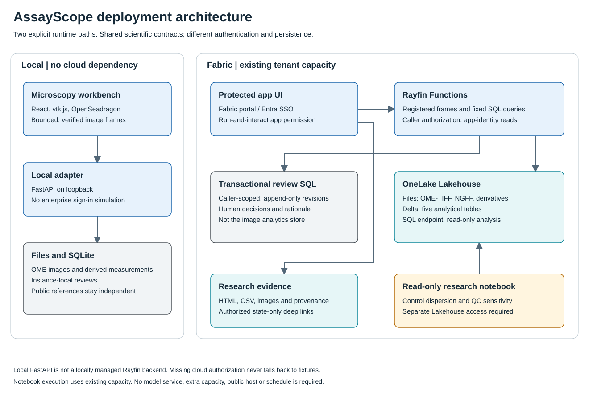
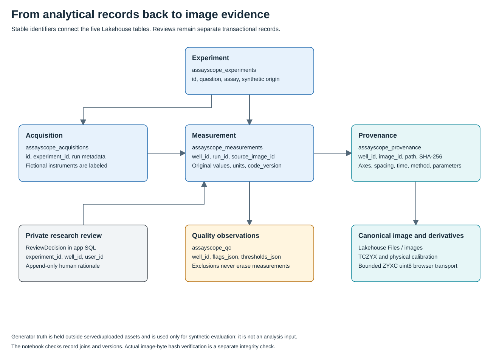

# Architecture and boundaries

AssayScope has two explicit runtime paths and one shared scientific contract. Local
operation needs no cloud services. The Fabric path stores images and analytical tables
in the chosen tenant and requires real authorization.

## Components and responsibilities

| Component | Responsibility | Boundary |
|---|---|---|
| React workbench | Plate navigation, calibrated images, comparison and research evidence | Display settings do not alter measurements |
| vtk.js / OpenSeadragon | Actual volume rendering and 2D navigation | Bounded derived frames, not a new source image format |
| Python image pipeline | OME conversion, image-only segmentation, measurements and QC | Does not consume generator truth |
| Shared catalog schema | Image shape, channel order, time, calibration and measurement contracts | Python validation and generated TypeScript declarations |
| Local FastAPI/files/SQLite | Local reads, analysis, export and durable review | Loopback instance; not enterprise sign-in or managed Rayfin |
| Rayfin protected app and Functions | Caller authorization, registered frame delivery and fixed SQL queries | No arbitrary storage URLs, SQL or local-data fallback |
| Lakehouse Files and Delta tables | Canonical images, bounded derivatives and five analytical tables | Large analytical data stays outside transactional review SQL |
| ReviewDecision entity | Caller-scoped human decisions and rationale | Append-only revisions, not a regulated audit trail |
| Research notebook | Read-only control dispersion, QC sensitivity and source lineage | Separate notebook/Lakehouse permissions; explicit execution |
| Ontology and data agent | Named research entities and read-only evidence questions over seven curated tables | Same reviewed data source; no private reviews or live LIMS connection |

## Data flow and identifiers

The [data dictionary](data-dictionary.md) defines the table grain and join keys.
Do not join different studies using well names alone: `A01` is not globally unique.
The registered experiment, acquisition/run, well identity and source image must agree.

The CPU pipeline writes Parquet inputs. The documented Fabric Load Table API creates
the five Delta tables. The SQL analytics endpoint is a **read path**, not a transactional
writer. Table-load completion and SQL metadata synchronization are separate gates.
Measurements retain source image IDs, processing version and original values.

Canonical source arrays are **TCZYX**. Physical spacing is recorded in Z/Y/X micrometers;
time is explicit. Browser transport is one bounded **ZYXC uint8** frame with a checked
hash. Labels align to that frame. The browser does not reinterpret channels from colors
or infer specimen/treatment identity from a filename.

## Authorization and persistence

The protected Fabric UI uses the portal's supported SSO flow. Functions verify the
caller before using the configured app identity to read the dedicated Lakehouse.
Storage/SQL tokens remain server-side. The app proxy is limited to the registered
demonstration experiment and is not a general multi-study entitlement service.

Reviews allow authenticated create/read only, scoped to `claims.sub == user_id`.
Cloud annotations are private to each author. Local SQLite reviews, by contrast, are
shared by users of that local instance. Neither is represented as a GxP audit system.
See [security](security.md) for verified and unverified authorization checks.

The optional notebook executes as an authorized notebook user and reads the attached
Lakehouse. **Permission to run the app does not grant permission to run the notebook.**
Notebook outputs and exported reports can contain scientific data; keep them within
the same approved access and retention boundary.

## Research analysis without a second implementation

`research/review.py` calls the existing Python `QCThresholds`, `qc_flags` and `summarize`
functions. The notebook builder embeds those exact function sources, along with the
tested report functions, into an output-free notebook. It records a source hash and
checks generated-file freshness. No package download or model endpoint is required
inside the notebook.

The notebook reads at most 10,001 records per table and rejects any input above 10,000,
mixed experiments, duplicate identities, broken joins, inconsistent QC or stale source
versions. It recomputes before/after QC **within each run**. It does not merge technical
replicates across runs or write tables, images or review decisions.

## Deliberate non-goals

The default deployment adds no extra capacity, model service, Kubernetes cluster,
public endpoint, Eventhouse or scheduled pipeline. A bounded microscopy review does
not need them. Additional services should follow a measured requirement, not a diagram.
[Platform extension criteria](fabric-research.md#when-another-platform-resource-is-justified)
describe what would warrant adding them.
The [ontology and lab-context boundary](knowledge-context.md) distinguishes deployed
managed knowledge items from the still-unconnected external system. The agent's
selected source is the curated Lakehouse, not an implied direct ontology tool.

Public-reference datasets are independent, attributed examples. Private generator truth
is held outside served and uploaded assets. Neither is an input to the tenant screening
table reduction. Real data needs a reviewed [adaptation](adapter-guide.md).

## Editing the diagrams

SVGs render directly in repository viewers. Their matching `.excalidraw` files are
editable, and `npm run docs:diagrams` regenerates both from the same layout source.
See [diagram sources](diagrams/README.md). These are architecture illustrations,
not screenshots or evidence that a resource was deployed.
