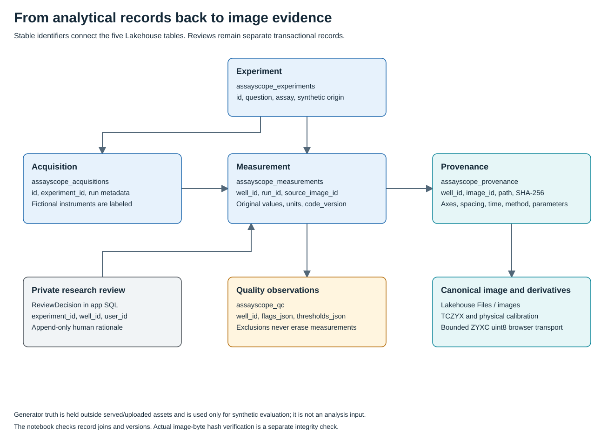

# Analytical data dictionary

The five Lakehouse tables are built by `assayscope/ingest.py`. The
[catalog JSON Schema](../contracts/catalog.schema.json) remains the shared image/measurement
boundary. This document describes the table projection; it is not a replacement schema.

## Grain and keys

| Table | Grain | Identity and joins | Default synthetic rows |
|---|---|---|---:|
| `assayscope_experiments` | One registered experiment | `id` | 1 |
| `assayscope_acquisitions` | One acquisition run | `(experiment_id, id)` | 2 |
| `assayscope_measurements` | One 2D screen field / technical well / run | `(experiment_id, well_id)`; `run_id -> acquisitions.id` | 192 |
| `assayscope_qc` | One stored baseline QC observation set per well | `(experiment_id, well_id) -> measurements` | 192 |
| `assayscope_provenance` | One canonical image acquisition per well | `(experiment_id, well_id, image_id)` | 198 |

There are six additional 3D companion acquisitions, hence 198 provenance rows for 192
2D screen measurements. Those companion volumes are not extra technical replicates.
Include `experiment_id` in joins. A display well such as `B11` repeats across runs.

## Experiment and acquisition metadata

| Table | Fields | Meaning |
|---|---|---|
| experiments | `id`, `title`, `question`, `assay`, `sample` | Declared scientific context, not inferred biology |
| experiments | `synthetic` | `true` for the supplied simulated assay |
| acquisitions | `experiment_id`, `id`, `label` | Explicit parent study and run identity |
| acquisitions | `instrument`, `acquiredAt`, `synthetic` | Declared instrument label, timestamp and origin |

The supplied instrument labels are fictional. A connection to Fabric changes the
access path, not the data's synthetic origin.

## Measurement fields

| Field | Type / unit | Interpretation |
|---|---|---|
| `well_id`, `well_name`, `run_id` | Text identifiers | Stable well identity, displayed plate coordinate and acquisition |
| `compound`, `dose_um` | Declared text; micromolar | Fictional condition metadata in this sample |
| `replicate` | Positive integer | Technical-well identifier within condition/run |
| `is_control`, `measured`, `synthetic` | Booleans | Control role, measurement availability and origin |
| `source_image_id` | Image identifier | The source 2D screen image; joins to provenance |
| `object_count` | Segmented nuclear objects per 2D field | Not automatically a cell count or viability measure |
| `median_area_um2` | Square micrometers; nullable | Median segmented nuclear area |
| `foreground_area_um2` | Square micrometers | Structural foreground area |
| `mean_signal_adu` | ADU; nullable | Background-corrected reporter mean inside foreground |
| `integrated_signal_adu` | Integrated ADU | Sum of background-corrected reporter over the field |
| `spheroid_volume_um3` | Cubic micrometers; nullable | Selected 3D companion mask volume at 48 h; not all wells have a volume |
| `focus_score` | Dimensionless | Laplacian variance / intensity variance |
| `saturation_fraction` | Fraction, 0..1 | Fraction of channel pixels at/above the defined saturation threshold |
| `illumination_cv` | Dimensionless | CV of structural-channel corner-patch means |
| `code_version` | Version plus SHA-256 | Processing-source fingerprint, not a source-image hash |

Original values are never overwritten when a reviewer excludes a well. Display
channels and contrast also do not alter them. Null is not zero.

## QC and provenance

`assayscope_qc.flags_json` is the recorded baseline flag list.
`thresholds_json` contains `focusMin`, `saturationMax`, `illuminationMax` and
`objectCountMin`. Active UI or report thresholds may differ; any sensitivity analysis
must record the thresholds actually used. Do not silently rewrite baseline QC.

| Provenance field | Meaning |
|---|---|
| `experiment_id`, `well_id`, `image_id` | Explicit lineage identities |
| `path`, `sha256` | Canonical image path and SHA-256 |
| `axes`, `shape_json` | TCZYX axis order and array shape |
| `voxel_um_json` | Physical spacing in Z/Y/X micrometers |
| `times_hours_json` | Actual time coordinates |
| `code_version`, `analysis`, `parameters_json` | Processing implementation and parameters |
| `processed_at` | Processing timestamp, separate from acquisition time |

A successful table join is not proof that remote image bytes match their stored hash.
The app's frame verification and cloud image integrity checks are separate operations.

## Derived research outputs

The report does not create a sixth analytical table.

| Output | Grain | Important interpretation |
|---|---|---|
| `runs.csv` | One run | Total = included + excluded + unmeasured; control CV is descriptive |
| `conditions.csv` | One compound/dose/run | Measured wells, included wells, estimable n, means and sample SD |
| `well_evidence.csv` | One original well | Original signal, normalized value, flags and canonical source hash |
| `research-review.json` | One review snapshot | Active/recorded thresholds, code version, input-table hash and all rows |
| `research-review.html` | Human-readable review | The same values, with explicit limitations and source lineage |

`estimable_n` counts included technical wells with a valid same-run control denominator.
It can be zero even when wells were measured. Sample SD requires at least two values.
The percentage-point difference compares two inclusion scenarios, not a causal effect.
The input-table hash is order-independent; it fingerprints table content, not image bytes.

## Separate transactional review schema

[`ReviewDecision`](../rayfin/data/ReviewDecision.ts) holds `id`, `user_id`,
`experiment_id`, `well_id`, `state`, `rationale`, `annotation`, `updated_at` and `version`.
Cloud revisions are caller-scoped and append-only. They are not replicated into the
research notebook and do not inflate analytical counts.

The [scientific method](scientific-method.md) defines formulas and limitations.
The [adapter guide](adapter-guide.md) explains what must be reviewed before mapping a
different assay onto this contract.
