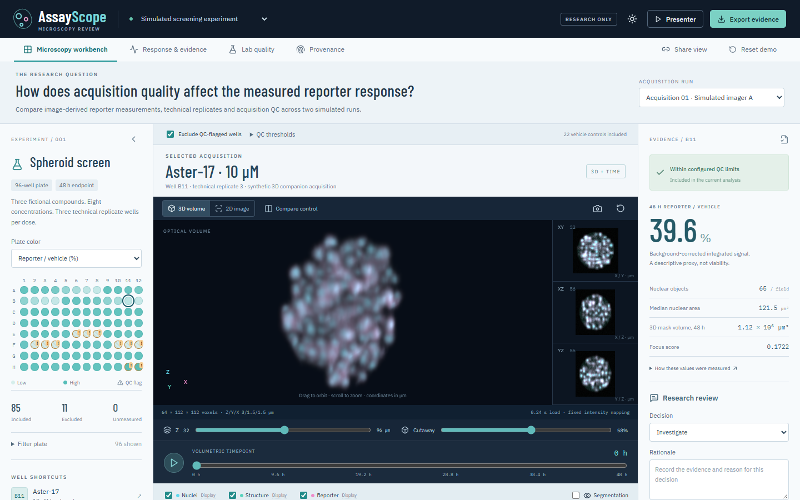
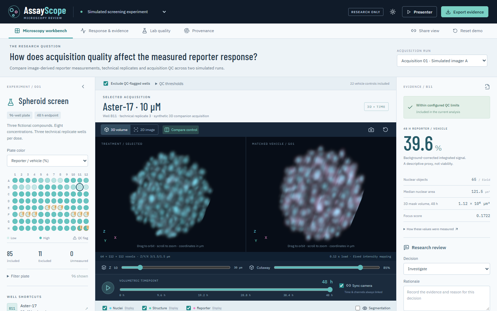
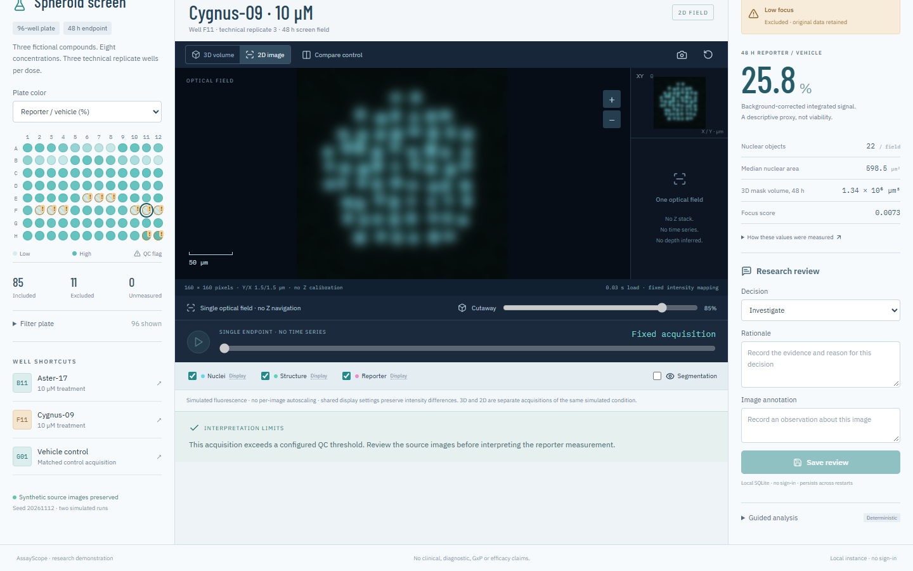
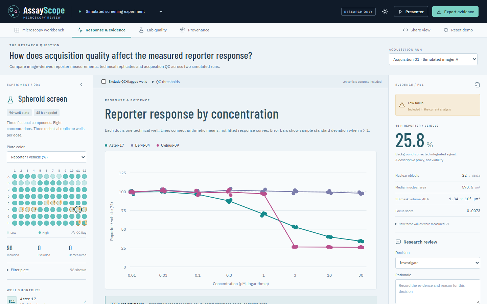
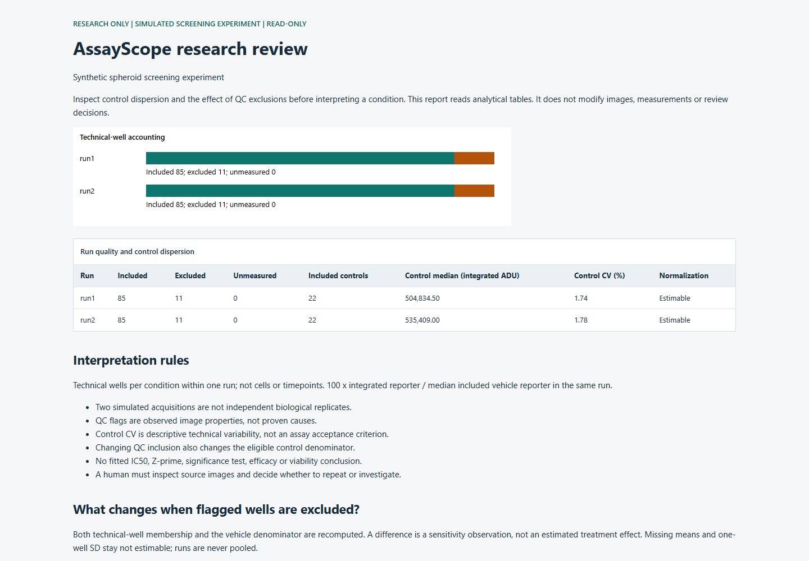
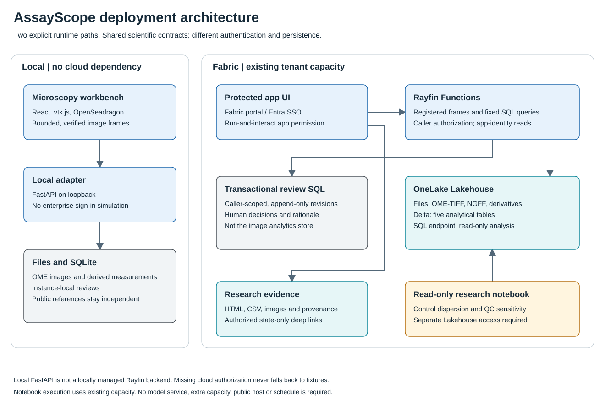
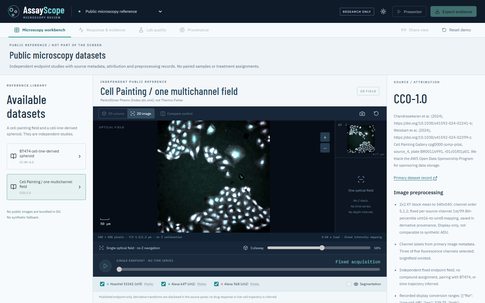
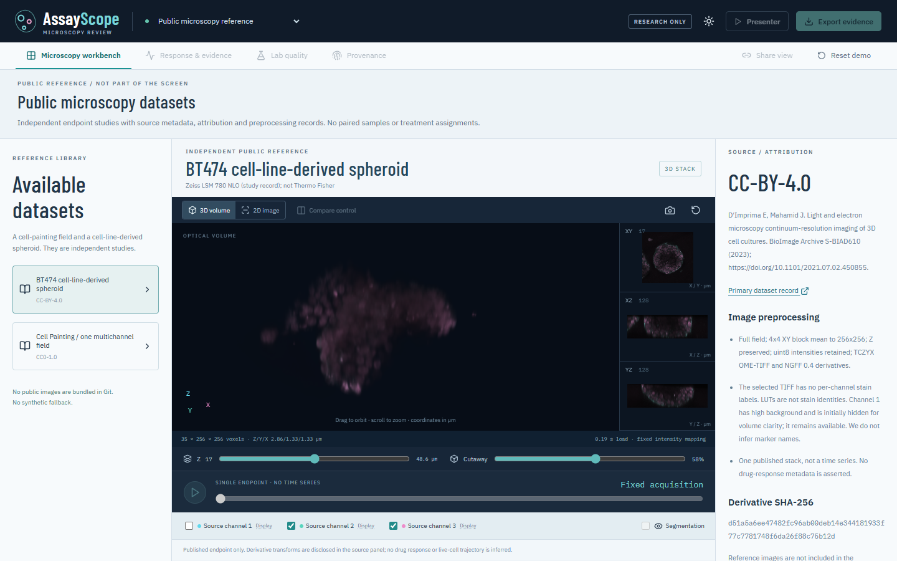

# AssayScope end to end

This walkthrough follows one research question from a plate result to the original
images, QC, a recorded human decision, reproducible evidence, and governed Fabric
analytics. Every screening image and compound in this walkthrough is **simulated**.
The public reference studies shown later are real, independently attributed datasets.

The pictures below are actual local application captures. They do not imply that
Docker, a different tenant or a different identity was tested.

## 1. Start with the study, not a chart

Follow the [native quickstart](../README.md#native-development) or open your authorized
Fabric app item. The header must identify the active experience. In connected mode,
check both **Connected tenant data** and the underlying **simulated** origin.



The default question is: **How does acquisition quality affect the measured reporter
response?** Each run has 96 wells: three fictional compounds, eight concentrations,
three technical wells per condition and 24 vehicle wells. There are two simulated
acquisition runs; they are not independent biological replicates.

Select **B11**. The plate coordinate, well identity, condition, image and evidence panel
change together. The reporter value is a background-corrected integrated image signal,
not viability, efficacy or a pharmacological endpoint.

## 2. Inspect the image in physical context

Switch channels on/off, inspect a 2D screen field, and use the selected wells' companion
3D volumes. Move the Z slider and cutaway. Play the six actual timepoints rather than
mistaking camera rotation for time.

Canonical arrays are **TCZYX**. The synthetic volumes have six timepoints, three channels,
64 Z planes and 112x112 pixels; Z/Y/X spacing is 3/1.5/1.5 micrometers. Single-plane
fields do not acquire an invented Z stack.

**Compare control** opens the selected well alongside the matched vehicle acquisition:



Keep display settings linked. Changing visibility or contrast does not change the
stored measurement. The 2D screen and 3D companion volume are separate acquisitions of
the same simulated condition, not the same field represented twice.

## 3. Investigate an apparent response with a QC problem

Select **F11**, then **2D image**. The low reporter measurement accompanies a low-focus
observation. The original image and value remain visible when the field is excluded.



The observation is “focus score below the configured threshold.” It does not establish
why that happened. In a real study, the lab must review acquisition settings, specimen,
processing and appropriate controls before assigning a cause or requesting a repeat.

## 4. Check whether the comparison depends on exclusions

Open **Response & evidence**. Each dot is a technical well. Lines connect descriptive
means; they are not fitted dose-response curves. Error bars are sample SD only when
at least two estimable technical wells remain.



This capture intentionally has **Exclude QC-flagged wells** unchecked. Turn it back on
and inspect the changed well/control counts, rather than comparing screenshots without
their inclusion settings.

With the default thresholds, each run changes from 96 measured wells to **85 included,
11 excluded, zero unmeasured**. There are **22 included vehicle wells**. At 10 micromolar
in run 1, all three Cygnus-09 technical wells are excluded; its after-QC mean is **not
estimable**, not zero. The vehicle denominator is also recomputed within the run.

[Scientific methods](scientific-method.md) contains the exact formulas and limitations.

## 5. Record a human research decision and export evidence

Choose a research state and supply a rationale. For example, a reviewer may record
that a low-focus acquisition needs investigation before interpreting the reporter
decrease. Guided analysis and the data agent must not save that decision automatically.

Local mode persists reviews in this instance's SQLite database. Cloud mode uses
caller-scoped append-only revisions. The cloud write/read-back and separate-identity
gates are documented independently in [verification](verification.md); do not infer them
from the local persistence demonstration.

**Export evidence** produces a ZIP with a readable HTML report, measurement CSV,
selected source-derived image snapshot, citations and a JSON provenance manifest.
Check the source hash, algorithm/code version, units, thresholds and excluded wells.
**Share view** encodes view state only; it neither contains credentials nor grants access.

## 6. Review controls and run-level sensitivity

Generate the research report locally:

```powershell
.\.venv\Scripts\python.exe -m assayscope.ingest
.\.venv\Scripts\python.exe -m research.review
```

Open `test-results\research\research-review.html`, or execute the separately authorized
Fabric research notebook:



The report contains separate run summaries, all 48 condition/run comparisons, 22
flagged wells and 192 source-lineage records. It uses the same tested Python reduction
as the application; it does not invent a second normalization method. Control CV is
descriptive technical variability, not a validated acceptance threshold.

See [research notebook setup and execution](fabric-research.md).

## 7. Make the Fabric data understandable to people and agents

The base deployment separates large scientific data from human review transactions:



The knowledge deployment creates a small, source-linked projection of the analysis:

| Layer | Contents | Purpose |
|---|---|---|
| Original five tables | Experiment, acquisitions, measurements, QC, provenance | Preserve source analytical records |
| Seven curated tables | Study/run/well/image/QC, condition summaries and example lab context | Make approved calculations and joins explicit |
| Ontology | Named research entities, keys, relationships and scientific rules | Shared terminology and source context |
| Data agent | Selected tables, read-only instructions and bounded query examples | Ask evidence questions using precomputed validated values |
| External context | Four fictional, versioned LIMS-export records | Demonstrate exact mapping and visibly missing context, not a live vendor connection |

The ontology and data agent use the same curated source. A source relationship does not
grant permissions. The data agent's runtime route must be described as it is configured,
not assumed to be a direct ontology source merely because both items exist.

Useful questions to test are:

- “How many wells are included and excluded in each run at the default QC thresholds?”
- “What changes after QC for the three fictional compounds at 10 micromolar in run 1?”
- “Which flagged wells have an external example sample or protocol record?”
- “Show the source evidence for run1-F11.”

Check answers against actual source rows and the deterministic report. A managed model
response is not scientific validation. [Knowledge deployment](knowledge-deployment.md)
gives the commands and exact access boundaries; [verification](verification.md) records
what actually ran.

## 8. Keep independent public references separate

The **Public microscopy reference** experience is available in local mode after a
separate, bounded download. It never supplies extra points for the screening curve.

| Cell Painting: one multichannel endpoint field | BT474: one real confocal stack |
|---|---|
|  |  |

Cell Painting is **CC0**. BT474 from **S-BIAD610** is **CC BY 4.0**. Unknown stain identities
remain unknown; the studies are not paired and no live-cell trajectory is invented.
Preserve [attribution](../THIRD_PARTY_NOTICES.md) when sharing these screenshots.

## 9. Reproduce the deployment in your own tenant

Prepare Node 24, Python 3.12, PowerShell 7.4+, Azure CLI, your own sign-in and an approved
workspace on an existing active Fabric capacity. Copy the empty
`config/tenant.example.json` to ignored `config/tenant.local.json`; complete only
owner-verified identifiers and prerequisites.

```powershell
npm ci
npm --prefix rayfin\functions ci
npm run fabric:doctor -- --config config\tenant.local.json
npm run fabric:plan -- --config config\tenant.local.json
npm run fabric:apply -- --config config\tenant.local.json --confirm-costs
npm run fabric:smoke -- --config config\tenant.local.json
npm run fabric:research:apply -- --config config\tenant.local.json --confirm-costs
npm run fabric:research:run -- --config config\tenant.local.json --confirm-costs
npm run fabric:knowledge:plan -- --config config\tenant.local.json
npm run fabric:knowledge:apply -- --config config\tenant.local.json --confirm-costs
npm run fabric:knowledge:publish -- --config config\tenant.local.json --confirm-costs
npm run fabric:knowledge:smoke -- --config config\tenant.local.json
npm run fabric:knowledge:evaluate -- --config config\tenant.local.json --confirm-costs
```

Follow the [full deployment prerequisites](deployment.md) before running these commands.
The direct Entra-to-Rayfin smoke needs the documented delegated execution scope;
portal SSO is an independent supported path. Publishing a data-agent version inside the
tenant does not make the app or data anonymous. The agent's MCP/model evaluation consumes
capacity and requires its own access. No command signs in, changes tenant policy or
creates/resizes capacity.

Real LIMS/ELN access, real assay adaptation and external write-back need separately
reviewed sources, credentials/rights and scientific validation. The complete sample
remains research-only even after every supported sample component is deployed.
