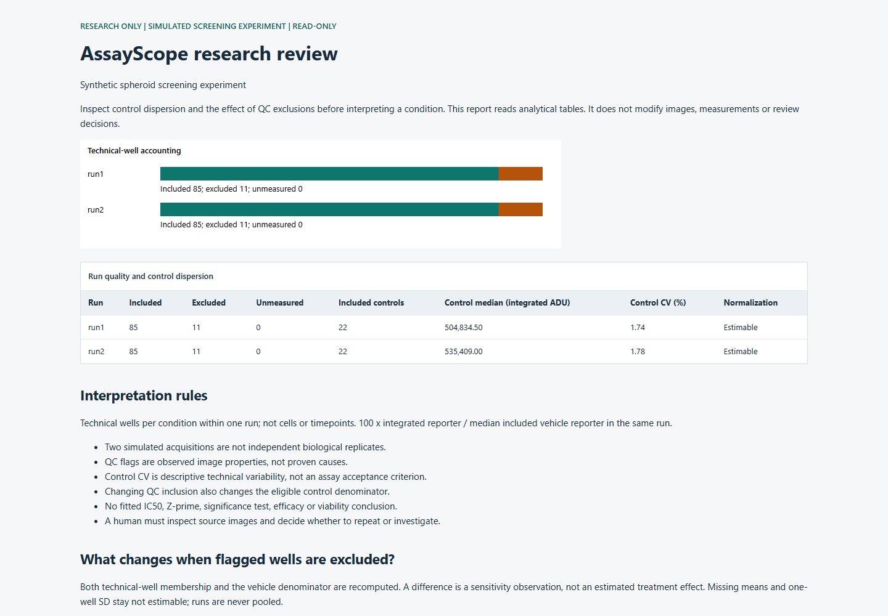

# Read-only research report and Fabric notebook

The research extension provides a reproducible view of control dispersion, QC exclusion
sensitivity and source lineage. It uses the existing five analytical tables, with the
same Python QC and reduction functions as the application. It does not train a model,
change measurements, infer biology or save review decisions.



*Rendered from the supplied image-derived synthetic tables. This is the local report,
not a screenshot of a managed data agent.*

## What a scientist can inspect

| View | What it answers | Interpretation boundary |
|---|---|---|
| Run accounting | How many wells are included, excluded or unmeasured? | Technical wells, not cells/timepoints or biological replicates |
| Control dispersion | How variable are included vehicle measurements within each run? | Descriptive CV, not a validated assay acceptance score |
| QC sensitivity | How do means and supporting n change with exclusion? | Both well membership and eligible control denominator can change |
| Image-review list | Which original acquisitions carry QC observations? | A human determines cause and next action |
| Source lineage | Which image ID, path and hash support each measurement? | Table consistency does not independently re-hash image bytes |

For the supplied synthetic pack, each run retains 85 of 96 measured wells and 22 vehicle
wells at default QC thresholds. Included-control CV is approximately **1.74%** and
**1.78%** for runs 1 and 2, respectively. These are simulated technical observations,
not performance claims about an instrument or biological assay.

## Run locally

After the [native setup](../README.md#native-development), prepare the image-derived
tables and render the report:

```powershell
.\.venv\Scripts\python.exe -m assayscope.ingest
.\.venv\Scripts\python.exe -m research.review
```

On macOS/Linux use `.venv/bin/python`. Open
`test-results/research/research-review.html` in a browser. The same directory contains
JSON and `runs.csv`, `conditions.csv`, `well_evidence.csv`. No external font, script,
model or web service is needed to read the HTML.

An alternate local table directory can be supplied with `--tables`; output can be
directed with `--out`. These are filesystem paths, not network endpoints.
Each Parquet file is bounded to 32 MiB and 10,000 rows. The supplied review deliberately
accepts only the registered, explicitly synthetic assay. Adapting it to real data
requires the scientific/data-rights review described in the [adapter guide](adapter-guide.md).

## Add one notebook to the existing Fabric workspace

Prerequisites: the base deployment's dedicated Lakehouse and tables; its exact ignored
tenant config; an authorized workspace Contributor; supported notebook creation and
execution access; and access to read that Lakehouse.

```powershell
npm run fabric:research:plan -- --config config\tenant.local.json
npm run fabric:research:apply -- --config config\tenant.local.json --confirm-costs
```

For a network-free source check:

```powershell
npm run fabric:research:plan -- --offline
```

The live plan verifies account/tenant/subscription, workspace and active existing
capacity. Apply creates `assayscope-<environment>-research-review`, or safely reconciles
its recorded source-owned item. The resolved Lakehouse is attached only in the deployed
definition; the [source notebook](../notebooks/research-review.ipynb) contains no tenant
coordinates or execution outputs.

**Apply does not start Spark.** It does not change capacity, create a schedule, add a
model endpoint, change permissions, upload public originals or overwrite analytical data.
The added item is recorded in the existing environment's cleanup inventory.
Unowned name collisions and external notebook edits stop the operation.

## Execute and inspect

```powershell
npm run fabric:research:run -- --config config\tenant.local.json --confirm-costs
npm run fabric:research:status -- --config config\tenant.local.json
```

The run command checks recent/active jobs before submitting one job, records its ID
immediately, honors Retry-After and polls with a bounded wait. It does not automatically
retry a run POST. A timed-out monitor is not permission to start a second run.
Use status and the notebook's Fabric run history.

Execution uses the existing workspace Spark capacity. It is not free just because no
new capacity is created. The notebook uses the workspace's configured runtime/pool;
this repository does not resize or reconfigure either.

The notebook reads bounded rows through Spark and displays the same report. Its final
cell returns an execution receipt containing table counts, input hash and run summaries.
Missing tables, mixed study identities, inconsistent QC and stale provenance fail
explicitly. A completed job is recorded separately from inspection of its result values.
See [verification](verification.md) for the actual deployed run and its evidence scope.

## Permissions and data handling

App-viewer permission alone is insufficient. A notebook author/operator needs separately
approved notebook execution and Lakehouse data access. Do not grant workspace Contributor
to every application viewer. No automatic role or policy change is made.

This report does not read private `ReviewDecision` rows. Notebook outputs can still
contain scientific measurements and identifiers: keep outputs, logs and exports inside
approved workspace/retention boundaries. Never commit executed notebook outputs,
customer data or resolved Lakehouse bindings to source.

## Keep the notebook reproducible

Edit `research/review.py` and the shared functions in `assayscope/analysis.py`, not the
generated code cell. Then run:

```powershell
.\.venv\Scripts\python.exe -m scripts.build_research_notebook
.\.venv\Scripts\python.exe -m scripts.build_research_notebook --check
.\.venv\Scripts\python.exe -m pytest tests\test_research.py
```

The tests cover same-run reduction parity, missing/zero/excluded controls, one-well SD,
order-independent snapshots, broken joins, stale QC, output escaping and notebook/local
result agreement. The canonical image-analysis code is not duplicated by hand.

## When another platform resource is justified

These are **future design choices, not deployed features**:

| Resource | Add only when this requirement exists | Additional review |
|---|---|---|
| Fabric Data Pipeline | Repeated, approved acquisition batches need scheduled ingestion with monitored failures | Source rights, overwrite policy, identity, capacity cost and schedule owner |
| Power BI semantic model/report | Multiple reviewed experiments need shared aggregate reporting | Assay comparability, grain, RLS, refresh, licensing and non-inflated n |
| Azure storage landing zone | Instruments need a reviewed transfer boundary outside the current Lakehouse path | Network/retention controls, least-privilege transfer identity and egress |
| Microsoft Purview governance integration | A real organizational catalog/classification workflow is required | Supported tenant features and governance ownership; not a compliance certification |
| Microsoft Foundry model endpoint | A validated, bounded explanation task cannot be met by deterministic evidence retrieval | Scientific grounding, model/data policy, cost limits and prompt-injection testing |

The current addition is intentionally just one notebook. More services alone would not
improve the interpretation of this small, bounded study.
The [Fabric IQ / LIMS extension](knowledge-context.md) addresses a specific next need:
source-linked sample, batch and protocol context, with a read-only agent evaluation plan.

## Supported API references

Checked against official documentation on 2026-11-13:
[create notebook](https://learn.microsoft.com/en-us/rest/api/fabric/notebook/items/create-notebook),
[notebook definition](https://learn.microsoft.com/en-us/rest/api/fabric/articles/item-management/definitions/notebook-definition),
[run item job](https://learn.microsoft.com/en-us/rest/api/fabric/core/job-scheduler/run-on-demand-item-job),
and [notebook execution/exit values](https://learn.microsoft.com/en-us/fabric/data-engineering/notebook-public-api).
This extension does not upgrade the pinned Rayfin 1.36.2 application.
