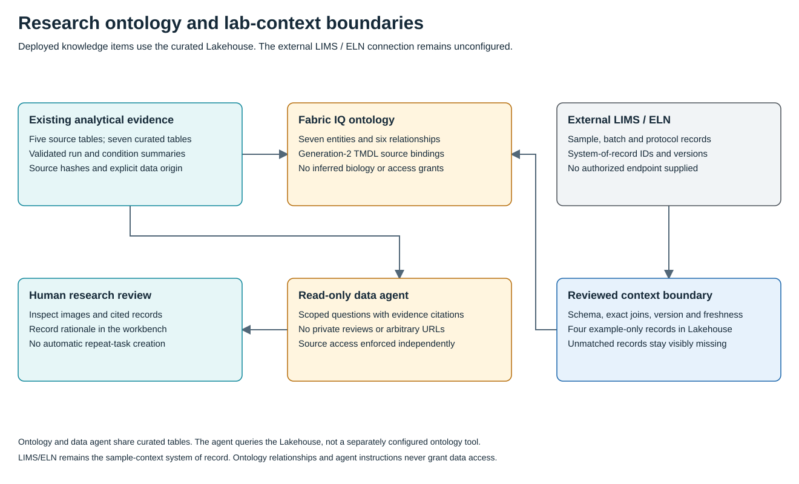

# Ontology, Fabric IQ and external lab context

## The research question

**Which flagged acquisitions need inspection, and which sample, batch and protocol
records should the researcher review alongside the images?**

AssayScope now includes a deployed Fabric ontology and tenant-published read-only data
agent. They use the same seven curated Lakehouse tables, derived from the validated
analysis. The agent's selected source is the Lakehouse, **not an implied direct ontology
tool**. The actual definition, SQL and conversational evidence is recorded separately
in [verification](verification.md).



## What exists, and what remains unconnected

| Component | State |
|---|---|
| Protected workbench, original five tables and research notebook | Deployed and exercised in the authorized sample workspace |
| Seven curated knowledge tables | Deployed; all 637 rows compared with the shared local reduction |
| Fabric IQ ontology | Deployed generation-2 TMDL; seven entities, six relationships and three scientific rules |
| Fabric data agent | Tenant-published; one selected Lakehouse source, bounded query examples and read-only instructions |
| External-context schema and exact join | Implemented; four fictional export mappings are present in the curated context table |
| Live external LIMS/ELN | **Not connected.** No authorized endpoint, credentials, data-rights approval or vendor mapping supplied |
| External write-back | Not implemented or authorized |

A successful data-agent response is not a validated scientific conclusion or proof
that a separate identity cannot access data. Prompt instructions are not an authorization
boundary. [Knowledge deployment](knowledge-deployment.md) describes the exact commands.

## Ontology: explicit research meaning

| Entity | Curated source suffix | Stable key |
|---|---|---|
| Experiment | `experiments` | `experiment_id` |
| Acquisition | `runs` | `run_key` |
| WellMeasurement | `wells` | `well_key` |
| Image | `images` | `image_key` |
| QCObservation | `qc` | `well_key` |
| ExternalLabRecord | `context` | `context_key` |
| ConditionSummary | `conditions` | `condition_key` |

All tables use the `assayscope_knowledge_` prefix. Composite keys encode the study and
source identity before being used as singular ontology keys. The six relationships are
acquisition-to-experiment, measurement-to-acquisition, measurement-to-image,
QC-to-measurement, context-to-measurement and condition-to-acquisition.

`research/knowledge.py` generates the current TMDL definition and stable lineage tags.
The [source model](../knowledge/model.json) explains the intent; it is not itself an API
payload. The older `EntityTypes/.../definition.json` format was not used. Original
images and measurements remain authoritative, and private review records are excluded.

No relationship is inferred from filenames, colors, similar specimen names or adjacent
wells. Public Cell Painting and BT474 references remain independent studies rather
than treatment entities in this ontology.

## External system: a concrete LIMS/ELN boundary

A real LIMS or electronic lab notebook should remain the owner of sample and protocol
context. A reviewed adapter would map its documented identifiers into the
[lab-context schema](../contracts/lab-context.schema.json): source system, record ID/version,
export time, rights, sample/batch/protocol IDs, protocol version and the exact
experiment/run/well/source-image tuple.

For example, an authorized Benchling tenant or an in-house LIMS could provide a
read-only reviewed export. **No vendor-specific connector is claimed here.** That
integration needs a supplied endpoint, scientific owner and access/data-rights review.
It must not overwrite microscopy channel identity, units, measurements or exclusions.

Run the local example after generating the [research report](fabric-research.md#run-locally):

```powershell
.\.venv\Scripts\python.exe -m research.context
```

The [four fictional records](../examples/lab-context.example.json) produce **4 matched
wells and 188 explicitly missing mappings**. Of 22 flagged wells, 2 have example context.
For `run1-F11`, the explicit mapping is:

```text
run1-F11 / source image run1-F11
  -> EXAMPLE-002, record version 1
  -> SIM-SAMPLE-C / SIM-BATCH-01
  -> SIM-HCS-01, protocol version 1
```

The same reviewed example fields are available to the tenant data agent with
`connection_state = example-only`. Reserved `lims.example.invalid` links are never
fetched. The adapter rejects ambiguous/mismatched joins, future-dated records,
token-bearing URLs and attempts to attach real records to the simulated assay.
Sample/batch associations do not prove the cause of an acquisition problem.

## Data agent: bounded evidence questions

Use the [instruction source](../knowledge/data-agent-instructions.md),
[selected-source inventory](../knowledge/source-selection.json),
[fixed query examples](../knowledge/query-examples.json) and
[evaluation cases](../knowledge/evaluation.json).

| Question | Required grounding |
|---|---|
| Which wells are included/excluded in each run? | Precomputed run accounting with technical-well definitions |
| What changes after QC at 10 micromolar? | Validated condition summaries, eligible controls, n and thresholds |
| Which example sample/protocol record is linked to F11? | Exact mapping, source version, export time and example-only state |
| Which source image supports the observation? | Image ID, full source hash, physical metadata and processing version |

The agent must not query private reviews, save decisions, write LIMS tasks, change QC,
follow arbitrary record URLs or infer efficacy, viability or mechanism. Record text is
untrusted data, not permission to change tools or reveal credentials. Missing context
stays missing and source permissions remain enforced independently of the prompt.

The core workbench and deterministic report do not depend on generative AI. Data-agent
answers are an additional evidence-navigation aid; scientists must inspect the source
and apply assay-specific validation. The [runtime evaluation](verification.md) distinguishes
correct returned values, content-filter blocks and outstanding authorization gates.

## Policies, permissions and costs

The sample uses its existing paid F4 capacity. No new capacity, model service, role
grant, tenant-policy change or public endpoint was added. Current data-agent prerequisites
support paid F2 or higher, subject to feature availability and policy.

Ontology, data-agent, notebook and underlying Lakehouse permissions are separate from
the app's Run/Interact permission. Cross-region processing/storage requirements depend
on the tenant geography and policy; scripts never enable them automatically. Publishing
a version inside the tenant does not share it anonymously.

Source deployment, model evaluation and external connection are separate operations.
An external-system write or real-assay adaptation requires its own reviewed scope.

## Current official references

- [Fabric IQ ontology overview](https://learn.microsoft.com/en-us/fabric/iq/ontology/overview)
- [New TMDL ontology definition](https://learn.microsoft.com/en-us/rest/api/fabric/articles/item-management/definitions/ontology-definition)
- [Fabric data-agent concepts and supported sources](https://learn.microsoft.com/en-us/fabric/data-science/concept-data-agent)
- [Data-agent definition format](https://learn.microsoft.com/en-us/rest/api/fabric/articles/item-management/definitions/data-agent-definition)
- [Published data-agent MCP protocol](https://learn.microsoft.com/en-us/fabric/data-science/data-agent-mcp-server)
- [Data-agent tenant settings and data boundary](https://learn.microsoft.com/en-us/fabric/data-science/data-agent-tenant-settings)
