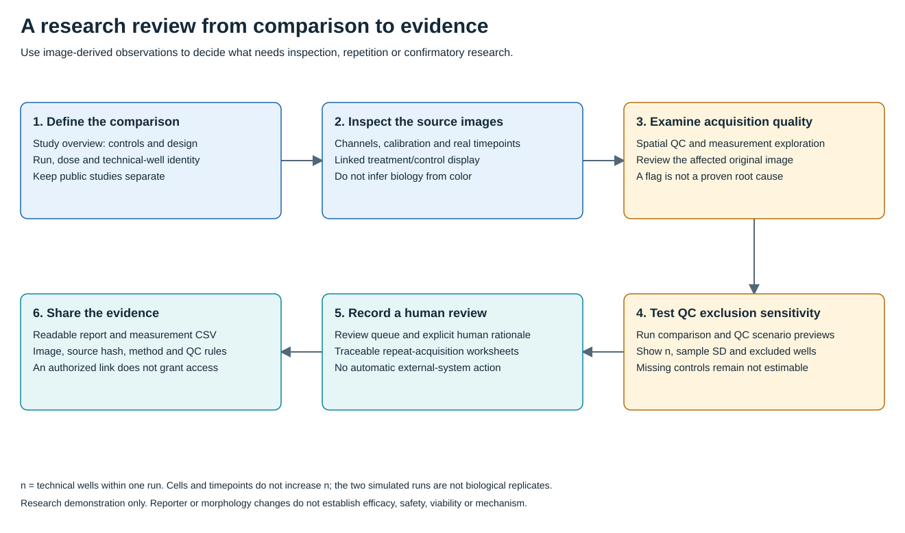

# Lab research guide

## What problem the sample addresses

A low reporter value can reflect an assay response, an acquisition problem, a processing
problem or a combination. A spreadsheet alone does not distinguish these explanations.
AssayScope keeps the measurement next to the source image, controls, technical-well
variability, QC observations and the reviewer's rationale.

The sample supports **evidence review and preparation for further research**. It does
not identify a successful drug, prove a mechanism, validate viability or replace the
scientific team's experimental design.

## Useful questions for a lab team

| Question | What the application supplies | What the team still needs to establish |
|---|---|---|
| Which acquisitions should we inspect before discussing a response? | Source-linked focus, saturation, illumination and count observations | Appropriate thresholds and causes for the real acquisition protocol |
| Does a condition retain enough technical support after QC? | Per-run included/excluded counts, individual points and sample SD | A predeclared inclusion policy and adequate biological replication |
| Are controls stable within each run? | Included-control counts, raw median and descriptive control CV in the research report | Assay-specific acceptance criteria and suitable reference controls |
| Is a conclusion sensitive to exclusion rules? | Before/after means and explicit changes in the control denominator | Whether exclusion is justified rather than selected to favor a result |
| Can we review another run without losing experimental context? | Separate run summaries, calibrated images and acquisition metadata | Whether the runs are comparable and how batch effects should be handled |
| Can an analyst reconstruct what was reviewed? | Original values, source hashes, algorithm parameters, code version and evidence export | Independent reproduction, data rights and authorized access |

Intended workflow benefits include less manual assembly of evidence and more consistent
review context. No customer productivity improvement, financial return or downstream
research outcome has been measured by this project.

## Walk through the simulated study

Use the default QC thresholds and keep **Simulated screening experiment** visible.
The same synthetic origin remains visible if the files are hosted in Fabric.

1. **Establish the comparison.** There are three fictional compounds, eight concentrations,
   three technical wells per condition and 24 vehicle wells in each run. There are two
   simulated acquisition runs, not two independent biological experiments.
2. **Inspect B11 and its vehicle comparison.** The 2D screen measurement and 3D companion
   volume are separate acquisitions of the same simulated well/condition. Keep display
   mapping linked. Camera motion is not time; the six timepoints are actual volume frames.
3. **Inspect F11.** Its low reporter value accompanies a low-focus observation. View the
   original 2D field and the configured focus threshold. The QC observation does not
   by itself identify an instrument fault or a biological cause.
4. **Compare inclusion scenarios.** At default thresholds, each run has 85 included,
   11 excluded and zero unmeasured wells. There are 22 included vehicle wells. Excluded
   wells retain their original measurements and remain inspectable.
5. **Record an explicit decision.** Use the workbench to save a rationale only after
   reviewing evidence. The deterministic Guided analysis and research notebook cannot
   write a decision for you.
6. **Export the evidence.** The ZIP includes the selected image, measurements, exclusions,
   citations and provenance. A state-only link restores context for an already authorized
   reader; it does not grant data access.

### A specific exclusion-sensitivity example

These are deterministic **run 1 synthetic** results at 10 micromolar, not real compound
potency or biological-effect measurements:

| Fictional compound | Measured technical wells | Included technical wells | Mean before QC | Mean after QC |
|---|---:|---:|---:|---:|
| Aster-17 | 3 | 3 | 39.72% | 39.80% |
| Beryl-04 | 3 | 3 | 99.31% | 99.52% |
| Cygnus-09 | 3 | 0 | 26.22% | Not estimable |

Percentages are integrated reporter relative to the median eligible vehicle reporter
**in that run and scenario**. Even Aster-17's mean changes slightly because excluding
flagged vehicle wells changes the denominator. Cygnus-09 does not become a zero response:
there are no included technical wells supporting that condition.

The research report reproduces this table from analytical records, not from scripted
presentation values. See [the executable workflow](fabric-research.md) and
[normalization rules](scientific-method.md#qc-inclusion-and-normalization).

## Use review states carefully

| Review state | Example rationale in this simulation | Not implied |
|---|---|---|
| Investigate | Inspect acquisition settings, segmentation and original reporter values before interpreting the comparison. | A confirmed root cause |
| Repeat acquisition | Low focus coincides with reduced reporter signal; review a repeat with matched acquisition settings. | A diagnosis of hardware failure |
| Prioritize for confirmatory research | Included technical wells support further study; design independent biological replication and an orthogonal assay. | Efficacy, safety, selectivity or a validated hit |

These are examples for human review, not automated recommendations for a real experiment.
Local reviews are shared by browsers using that local instance. Cloud review revisions
are private to their author; this version does not implement a shared team approval queue.

## Evaluate benefit in your lab

Run a small, rights-approved evaluation before introducing real assay data. Compare a
defined review task with your existing workflow using the same evidence and reviewers.
Record the task definition, sample size, counterbalancing/order, errors and uncertainty.

| Outcome to measure | Suggested observable definition | Safeguard |
|---|---|---|
| Evidence retrieval effort | Time from selecting a condition to opening the correct source image and method | Record actual timings; do not substitute app load times |
| Traceability completeness | Fraction of reviewed findings with source ID/hash, units, method and inclusion rule | Missing metadata remains missing; do not infer it |
| QC review consistency | Agreement with independently adjudicated acquisition observations | Use a representative real validation set, not just seeded artifacts |
| Review reconstruction | Whether a second authorized reviewer reproduces the displayed values from the bundle | Count disagreements and missing evidence, not just successes |
| Repeat-work documentation | Fraction of human repeat decisions with an explicit reason and referenced field | A documented repeat is not an avoided experiment or a financial saving |

The recorded browser timings describe this bounded demo, not laboratory productivity.
Do not extrapolate synthetic segmentation scores to a new specimen or microscope.

## Before using a real assay

Agree on data rights, access, retention, experimental units, controls and biological
replicate design. Validate segmentation and QC against appropriate annotations and
acquisition checks. Preserve original intensities, exclusions, calibration and real
time coordinates. A channel name must come from acquisition metadata, never a color.

The [OME importer](adapter-guide.md) is a bounded conversion tool, not a finished
instrument/LIMS integration. The [example metadata CSVs](../examples) are schemas to
review with the scientific owner. Real assays need a reviewed catalog mapping, tailored
methods, focused tests and target-tenant authorization checks before sharing.

Public Cell Painting and BT474 files remain **independent reference studies**. They are
not treatment/control pairs, do not acquire fictional drug metadata and are never pooled
into the screening response analysis.
