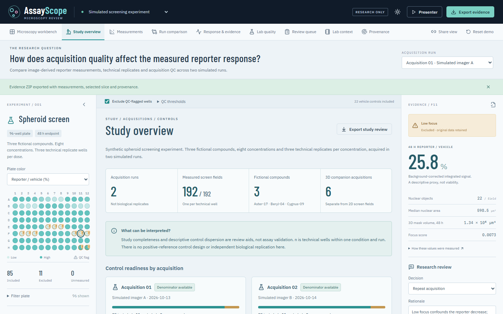
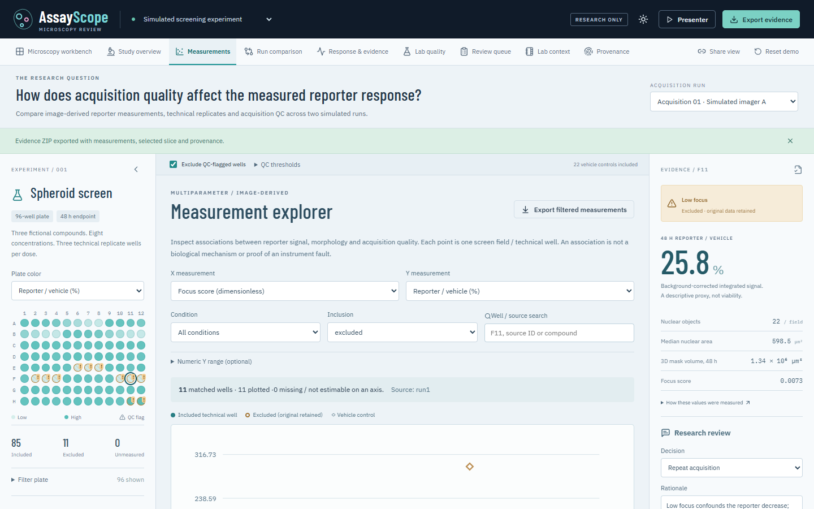
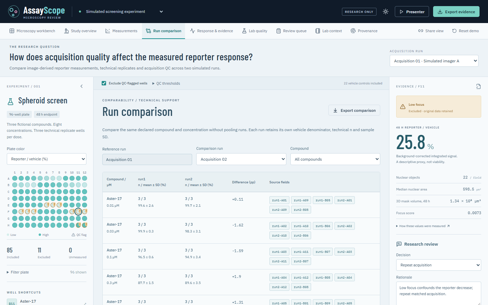
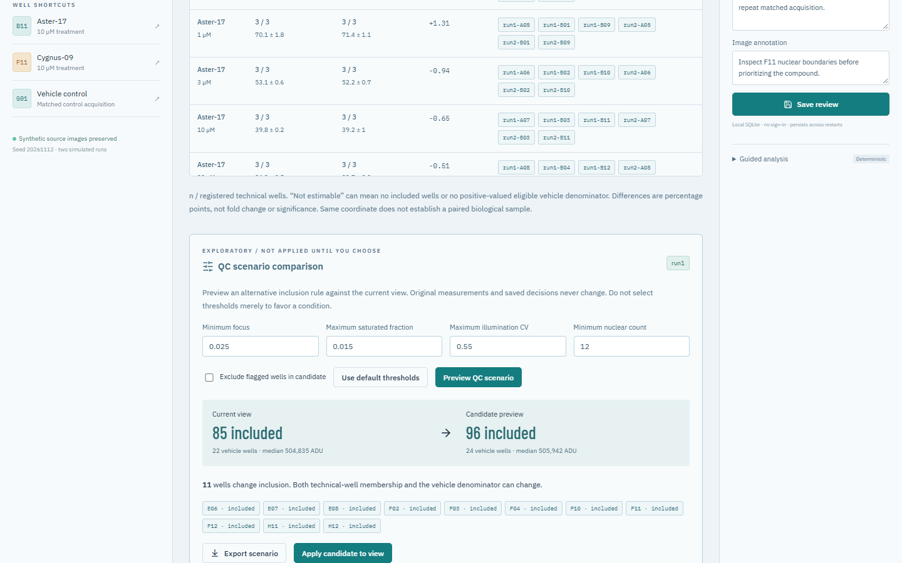
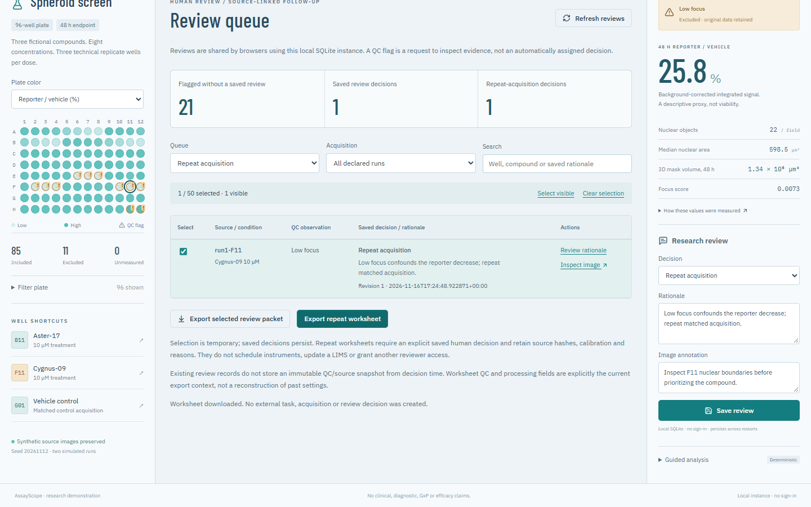
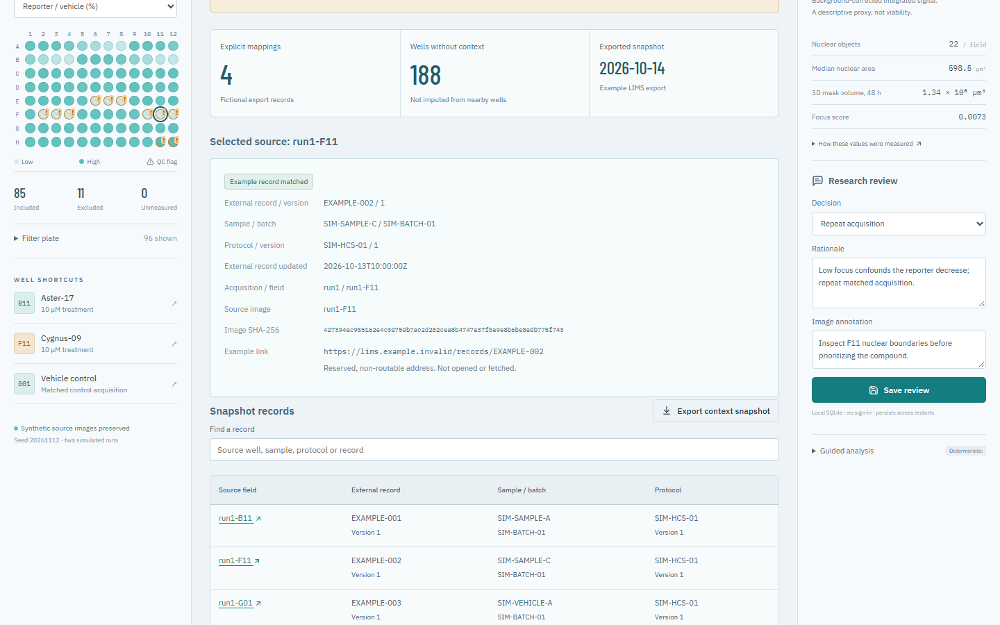
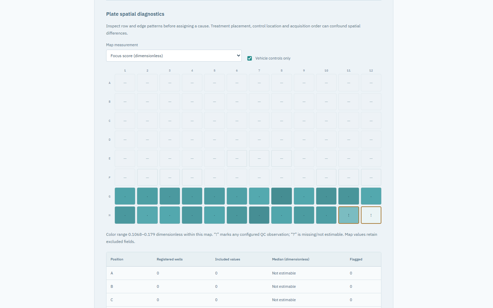

# Integrated laboratory research workflows

The browser application now exposes study review, multiparameter exploration,
cross-run comparison, explicit QC scenarios, saved-review queues and lab-context
inspection. These are working views over the same source-linked study, not separate
mock dashboards or a claim that the sample supports arbitrary production assays.

The supplied study still has two simulated 96-well acquisitions and fictional
compounds. Research-only limits apply to every screen and download.

**Rollout status (2026-11-16):** these views are implemented and browser-tested locally.
Updating the existing protected Fabric app is blocked while its assigned capacity is
inactive; no unapproved resume was performed. Earlier tenant verification does not
establish that these new surfaces are live yet.

## Study overview: controls before interpretation

Open **Study overview** to inspect the registered design, measurement coverage,
companion-volume coverage, declared acquisition timeline and per-run vehicle controls.
Control medians and inclusion come from the selected adapter; control CV is computed
from the corresponding included original values and checked against that denominator.
Runs are retrieved with at most two concurrent requests; stale requests are discarded.

The view reports rather than invents readiness:

- Vehicle denominator available or not estimable.
- Registered versus measured fields and estimable compound/dose conditions.
- Positive-reference control separation **not established**; no Z-prime.
- Independent biological replication **not established**; runs do not become biological n.
- Source hashes/calibration declared in the catalog; actual frame-byte verification
  still occurs when an image is loaded.

**Export study review** downloads run-level statistics, QC settings, processing
provenance and source-image identities. It is not a validated assay release certificate.

## Measurement explorer: follow an observation to its image

Open **Measurements** and choose X/Y measurements. Available axes include normalized
reporter, original integrated reporter, nuclear-object count/area, structural area,
48 h companion-volume size, focus, saturation and illumination CV.

Filter by condition, inclusion status, source/well search or optional numeric Y bounds.
The scatterplot counts missing axis values explicitly. A well without a companion
volume is missing on that axis, not a zero-size spheroid. Excluded wells retain their
original values and use a distinct marker. Select a point with mouse or keyboard to
open its actual source image. The sortable paginated table is another navigation path.

Filters affect this exploratory display only; they do not change global QC or measurements.
**Export filtered measurements** includes every matching row, units, missing values,
source hashes and the exact filter/analysis scope, not just the visible table page.
No correlation is presented as a mechanism or causal explanation.

## Run comparison: keep the experimental units separate

Open **Run comparison**. Each compound/dose row shows technical n against registered
well count, mean, sample SD and source wells for each acquisition. The difference is
right-run minus left-run mean in **percentage points**; it is not a significance test,
fold change, batch correction or biological reproducibility estimate.

Each run uses its own eligible vehicle median. Missing/zero controls, no included
technical wells, or missing conditions remain not estimable. SD requires two estimable
values. All source-well links return to image evidence. A paired plate coordinate does
not prove a paired biological specimen.

## QC scenarios: inspect sensitivity before applying a rule

Within **Run comparison**, change the candidate thresholds or inclusion switch and
select **Preview QC scenario**. This performs an actual adapter analysis request;
there is no fabricated preview. The current view stays unchanged until
**Apply candidate to view** is selected.

The comparison exposes both changed well membership and changed control denominator.
An unchanged treatment field can have a different normalized value if a flagged vehicle
well is removed. Candidate results disappear when their source/options no longer match.
Exports record current and candidate settings, denominators, original measurements
and individual inclusion changes.

This is exploratory sensitivity analysis, not a recommendation to choose the thresholds
that produce a desired result. Applying a scenario never modifies pixels, stored
measurements, baseline QC or saved review decisions.

## Review queue and repeat-acquisition worksheets

Open **Review queue** to see flagged fields without a saved review, all fields, unsaved
fields or a selected human decision state. Search saved rationales and filter by run.
**Review rationale** selects a field without leaving the queue; the shared right-hand
editor saves through the same local/cloud review path used by the workbench.

The queue loads persisted records, not an in-memory list of recent clicks. Local reads
are restricted to registered wells in this SQLite instance. Cloud reads retain the
existing caller-scoped entity permissions and paginate in pages of 100, with a hard
2,000-revision inventory bound. Reaching the bound or losing access fails visibly; no
partial list is labeled complete and no failure is presented as an empty queue.

Select up to **50 fields** for a review packet. A repeat-acquisition CSV additionally
requires every selected field to have a saved human **Repeat acquisition** decision.
It contains the rationale, original measurement, QC settings, source hash, calibration,
processing version and explicit simulated origin.
Existing review records do not contain an immutable analysis/QC snapshot from the time
of the decision. Worksheet QC/source-version columns are labeled as the **export**
context; the application does not reconstruct historical settings or claim a regulated
audit record.

Neither export submits a LIMS task, schedules an instrument, sends an email, creates
a shared approval or changes a decision. Selection is temporary; the saved decisions
persist. Cloud records are private to the author; local browsers share the instance.

## Lab context: make missing context visible

Open **Lab context**. Local mode reads the schema-validated example snapshot; Fabric
mode retrieves that bounded snapshot from the authorized OneLake prefix through
Functions. A failed cloud read never falls back to a bundled local example.

The view joins the exact experiment/run/well/source-image tuple, displays sample/batch
and protocol IDs/versions, export/update timestamps, rights and image hash, and exports
the inspected snapshot. Four fictional mappings exist; the other 188 wells remain
explicitly missing. Reserved `.example.invalid` addresses are displayed as text, not
opened. A mapping does not prove biological relatedness or explain an acquisition fault.

This is **not a live LIMS/ELN connector**. A real external system needs an authorized
endpoint, rights, reviewed metadata mapping and separate validation.
See [ontology and lab-context boundaries](knowledge-context.md).

## Spatial QC: look for patterns without assigning a cause

In **Lab quality**, inspect the rectangular plate map and switch the displayed metric
or restrict it to vehicle wells. Every enabled cell opens its original image.
The map retains excluded values; row and edge/interior summaries use only included,
estimable values and expose their n.

Outer edge means row A/H or column 1/12. Different positions can contain different
compounds/doses; a descriptive edge/interior difference is **not** an edge-effect test.
Sparse control placement and unmeasured positions stay visible.

## Share and export scope

View links now preserve source, run, active surface, display and bounded QC settings.
They still contain no credentials or private review text. Temporary explorer filters,
scenario drafts and queue selections are not included; use a tabular packet to preserve
those scopes. Links never grant access.

Research packets contain `report.html`, `records.csv`, `manifest.json` and `citations.txt`.
They are distinct from the original **Export evidence** ZIP with its selected image.
Spreadsheet-formula prefixes and HTML are escaped; numeric measurements remain numeric.
Tabular packets are bounded to 1,000 records, 64 columns and 16 MiB before compression.

## Relevance to large discovery and imaging teams

| Evaluation audience | Concrete workflow to demonstrate | What is not claimed |
|---|---|---|
| Imaging/platform teams, including Thermo Fisher Scientific discussions | Multiparameter image QC, calibrated volumes, spatial inspection and repeat-acquisition worksheets | A certified instrument integration or replacement for validated vendor analysis |
| Discovery teams, including Merck & Co./MSD and AbbVie discussions | Control completeness, per-run technical support, QC sensitivity, original-image review and confirmatory-research rationale | Customer deployment, endorsement, real drug efficacy, biological replication or a validated hit |
| Informatics/platform owners | Exact context joins, source hashes, private review records, reproducible exports and fail-closed data access | GxP compliance, full team approval workflow or a live LIMS connection |

These are generic research-software evaluation tasks, not undisclosed requirements of
the named companies. Thermo Fisher's primary
[high-content analysis overview](https://www.thermofisher.com/us/en/home/life-science/cell-analysis/cell-analysis-learning-center/cell-imaging-information/high-content-analysis-information.html)
describes multiparametric quantitative imaging. [Merck & Co. research](https://www.merck.com/research/)
provides discovery context, not an endorsement of this sample. “Merck” here means
Merck & Co./MSD, not Merck KGaA/MilliporeSigma.

The application still contains one reviewed synthetic study. Adding more real studies,
roles, instrument control or shared approval processes requires explicit domain,
authorization and validation work, not a renamed demo counter.
